# Tidepass - book the boat, see it live

A React Native (Expo) MVP of a real-time boat charter marketplace: guests browse destinations, search by date and party size, and only see boats that still have space. Seat counts come live from operator systems, a departure's seats are held for 10 minutes while the guest pays, a declined card or an expired timer puts them straight back on sale, and when two people go for the last seats in the same instant exactly one wins and the other is offered live alternatives. Built with TypeScript and Zustand on a pure availability engine with unit tests.

## Demo


Captured on an Android emulator. The same codebase builds for iOS.

## Screens

| Onboarding | Sign in | Explore | Destination |
|---|---|---|---|
| 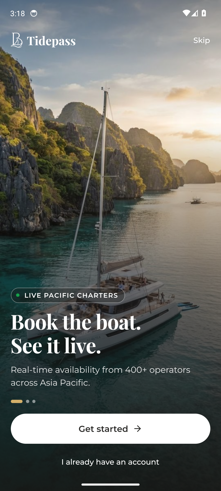 | 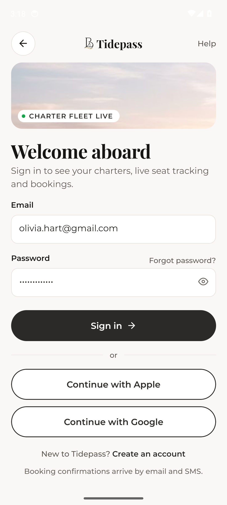 | 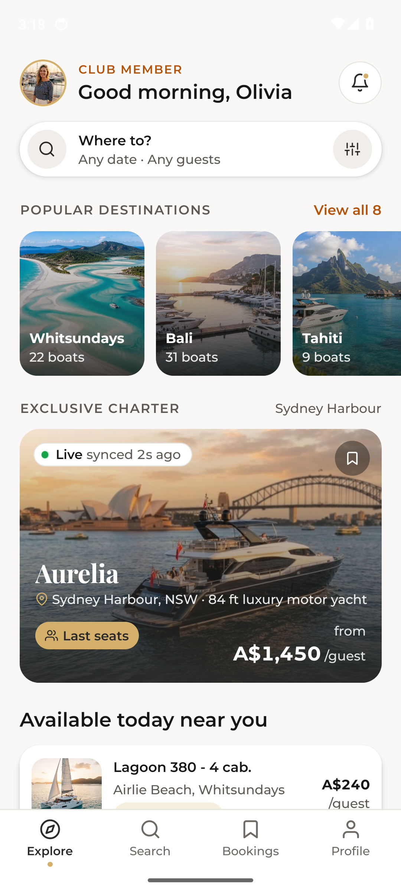 | 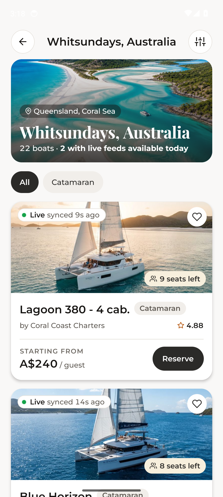 |

| Boat detail | Departure calendar | Last seats taken | Checkout hold |
|---|---|---|---|
| 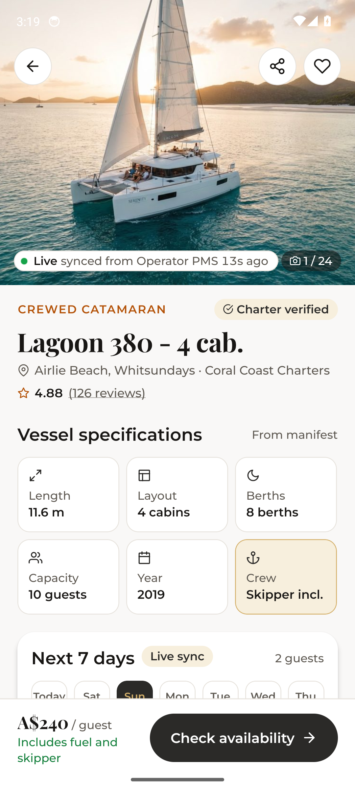 | 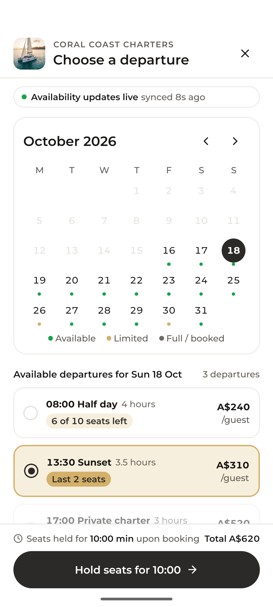 | 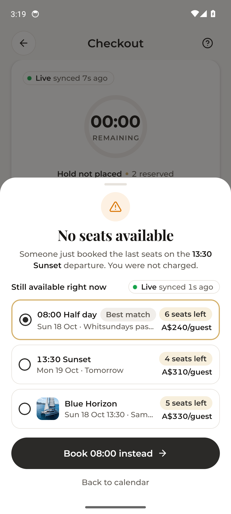 | 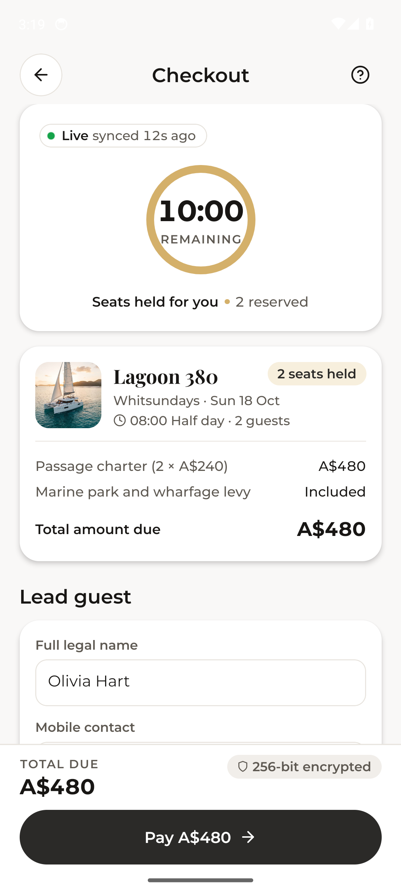 |

| Booking confirmed | Booking detail | My trips | Search results |
|---|---|---|---|
| 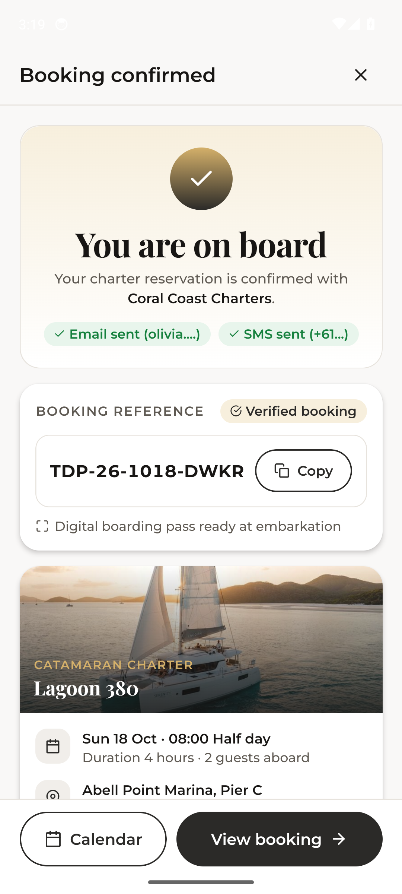 | 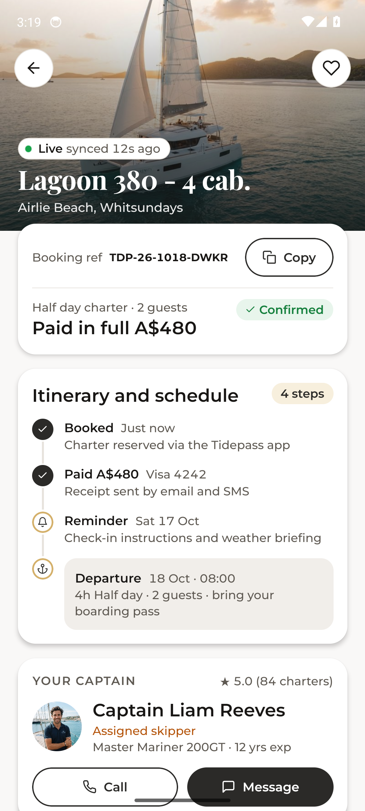 | 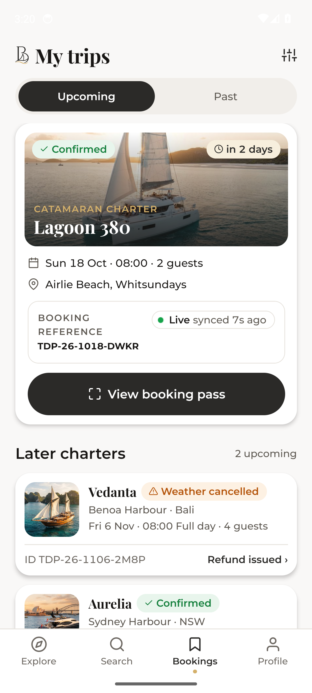 | 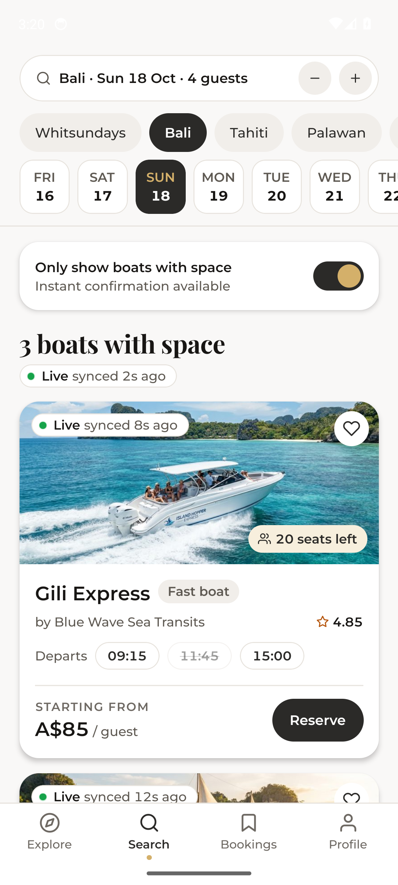 |

| Fully booked | Profile | Operator console | Notifications |
|---|---|---|---|
| 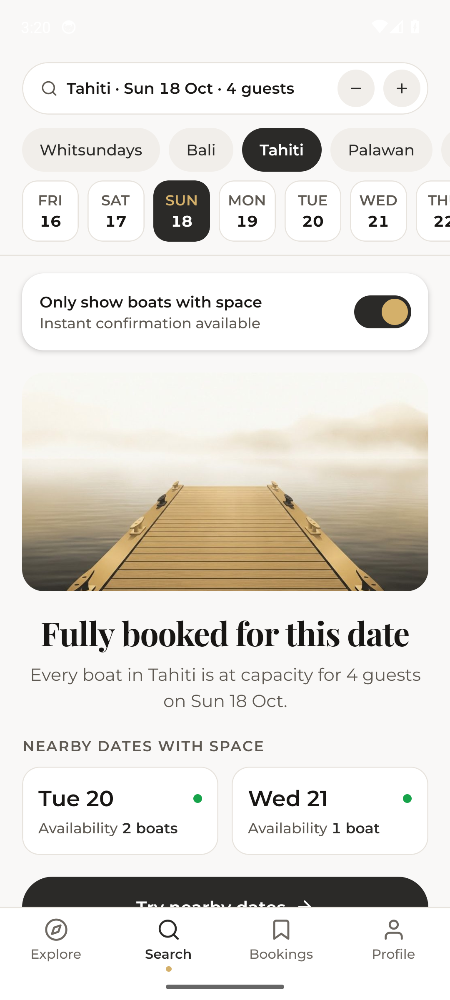 | 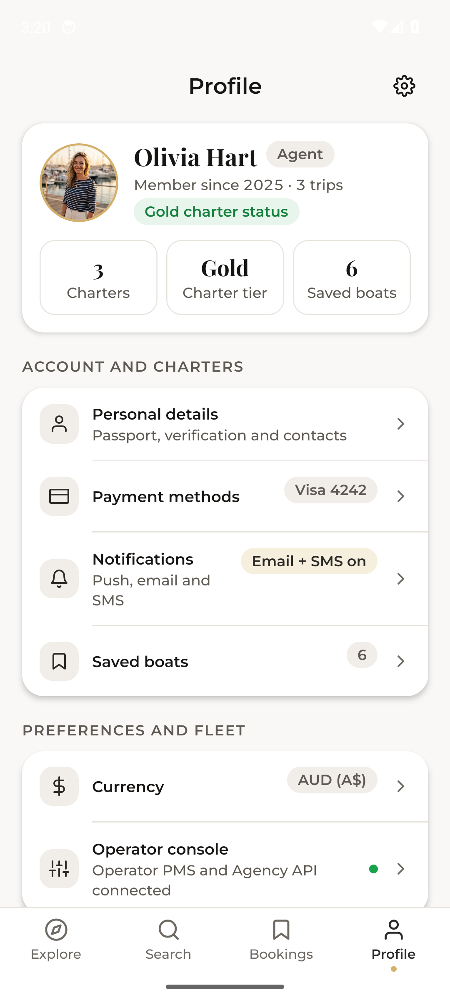 | 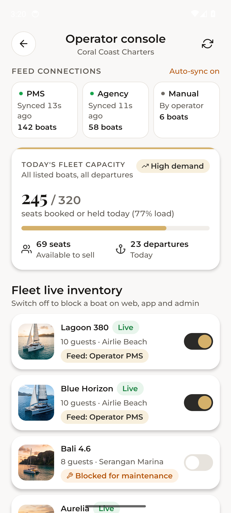 | 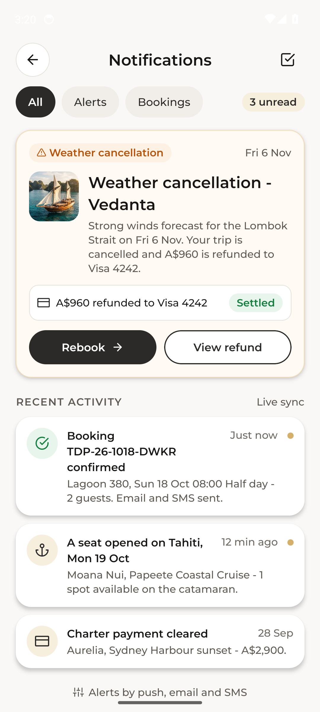 |

## What it shows

- **Live availability everywhere**: every listing and detail carries a Live pill ("synced from Operator PMS 8s ago"), seats-left chips and a "Last seats" state; the boat page has a 7-day availability strip and the calendar marks each day available, limited or full for the current party.
- **Search that only shows boats with space**: destination, date and guests, with an "Only show boats with space" switch; when nothing fits, a fully booked state lists the nearest dates that still have room.
- **Departure picker**: month calendar, departure slots with live seats (for example "6 of 10 seats left", "Last 2 seats", "Full"), adults and children steppers and the total before holding.
- **10-minute seat hold**: the checkout countdown ring shows the seats are already off sale for everyone else; "Test decline" simulates a failed card and the seats are released at once, and the timer running out does the same.
- **Last-seat race**: in the demo an operator-system booking for the same departure lands in the same instant as the guest's hold. The engine lets exactly one through; the guest sees "No seats available, you were not charged" with live alternatives (another slot that day, the same slot tomorrow, a similar boat) and books one in a tap.
- **Booking reference and confirmations**: unique `TDP-YY-MMDD-XXXX` references, email and SMS sent chips, booking detail with an itinerary timeline, skipper and meeting point.
- **Cancel and release**: refund breakdown and a cancel that returns the seats to sale instantly.
- **Weather / operational cancellation**: a notification with the refund and a one-tap rebook.
- **Operator console**: status per feed (Operator PMS, Agency API, manual calendar), today's fleet capacity, rejected conflicting feed bookings and a switch that blocks a boat from all listings.

Operator feeds, payments, email and SMS are simulated with mock data so every screen runs on an emulator with no backend.

## App flow

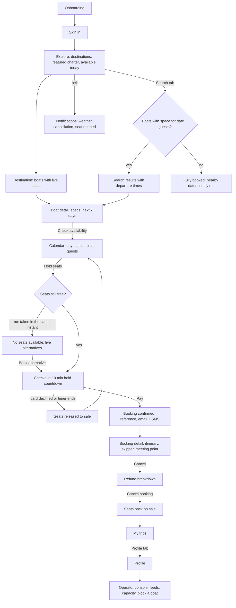

## Architecture

```
src/
  app/                       expo-router screens
    index.tsx                onboarding
    sign-in.tsx              sign in (social buttons simulated)
    (tabs)/                  explore, search, bookings, profile + shared four-tab bar
    destination/[id].tsx     boats in one destination
    boat/[id].tsx            boat profile, next 7 days
    calendar/[id].tsx        departure picker
    checkout.tsx             hold countdown, payment, last-seat race sheet
    confirmed/[id].tsx       booking reference
    booking/[id].tsx         booking detail
    cancel/[id].tsx          cancellation + refund
    notifications.tsx        alerts and activity
    operator.tsx             operator console
  logic/
    inventory.ts             availability engine (pure functions, node:test unit tests)
    dates.ts                 date math on YYYY-MM-DD strings
  store/                     Zustand store over the engine + search selectors
  data/                      boats, destinations, seeded departures, bundled photography
  components/                Live pill, seats chip, boat card, sheet, chips, tab bar
  theme/tokens.ts            graphite + brass palette, Montserrat + Playfair Display
design/                      source design: per-screen HTML, DESIGN.md, brief.json
```

- **Availability engine** (`src/logic/inventory.ts`): per-departure capacity, booked count and timed holds. `seatsLeft = capacity - booked - active holds`, zero when the boat is blocked or the departure is cancelled. `hold` refuses when the seats do not fit, `confirm` is idempotent per hold and fails on an expired hold or a declined card (releasing it), `cancel` returns seats, `remoteBook` runs operator-system bookings through the same capacity check, `weatherCancel` refunds and removes the departure. Every function takes and returns an immutable state, so the UI, the simulated feeds and the tests share one set of rules.
- **Unit tests** (`npm test`): the RTB-001 last-seat race, holds taking seats off sale, declined payment and hold expiry releasing seats, idempotent confirm, cancel releasing seats, blocked boats, weather cancellation, feed bookings rejected instead of overbooking, 10,000 unique booking references and a 2,000-step mixed load that never exceeds capacity.
- **State**: one Zustand store holds the engine state, search query, party size and the active hold; a background tick simulates operator feeds booking seats on other boats.
- **Production path**: the engine maps to a server-side inventory service (a transactional `UPDATE ... WHERE capacity - booked - held >= :seats`), operator connectors (polling or webhooks) feeding `remoteBook`, and push / websocket updates to the Live pills.

## Run

```bash
npm install
npx expo start          # press a for Android, i for iOS
npm test                # availability engine unit tests
npm run typecheck
```

Requires Node 22. No backend or API keys needed.
